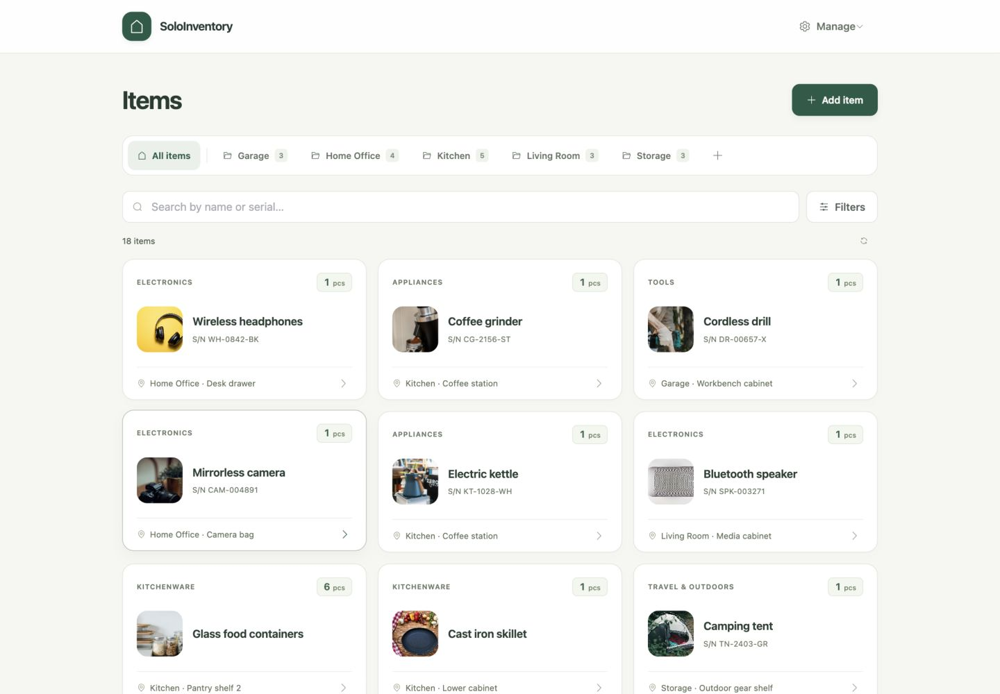

# SoloInventory

A self-hosted household inventory. Keep track of what you own, how many you have, and where it is stored.



The screenshot uses illustrative data. [Photo credits](docs/images/README.md).

## Features

- Organize items into flat sections and shared categories.
- Record a name, quantity, location, serial number, purchase date and expiry date.
- Add one optional photo per item, from the camera or photo library. Replace or remove it later.
- Reuse location suggestions within each section.
- Search names and serial numbers, with combined section, category and location filters.
- Edit every field, move items between sections, and permanently delete items after confirmation.
- Use one shared household account. Inventory records, settings and photos require sign-in.
- Use the responsive English interface or install the Android PWA over trusted HTTPS. Dates use DD/MM/YYYY.
- Store the database and private photos locally, with a consistent backup command.

Names and serial numbers may repeat. Quantity is a whole number from 1 to 999999. Photos support JPEG, PNG and WebP, up to 12 MiB and 8000 pixels per side. Expiry dates are informational; there are no expiry alerts or reminders.

SoloInventory requires a connection to its server. It does not cache inventory data or queue changes offline. There is no registration, multi-user management, trash or offline synchronization. iPhone support has not been verified.

Built with Laravel 13, PHP 8.4, Vue 3, Element Plus, Tailwind CSS and SQLite.

## Install with Docker Compose

You need Git, Docker with Linux containers, and Docker Compose 2.24.4 or newer. The image build has been checked for `linux/amd64` and `linux/arm64`. PHP, Composer and Node.js are only needed inside the build containers.

The app image is built from this repository. No published SoloInventory image is required. Run the following commands from the repository directory. They use the standard Docker CLI; RTK is optional.

### 1. Get the source and build

```sh
git clone https://github.com/metalogico/soloinventory.git
cd soloinventory
cp .env.example .env
chmod 600 .env
docker compose build app
```

### 2. Configure the account

Generate a key and a bcrypt password hash using the image you just built:

```sh
docker compose run --rm --no-deps app php artisan key:generate --show --no-interaction
docker compose run --rm --no-deps app php artisan soloinventory:password-hash
```

The password command prompts without echoing the password and requires at least 12 characters. Edit `.env` and set:

```dotenv
APP_KEY=base64:paste-the-generated-key
SOLOINVENTORY_USERNAME=choose-a-username
SOLOINVENTORY_PASSWORD_HASH='paste-the-generated-bcrypt-hash'
```

Keep the bcrypt hash in **single quotes**, so Compose preserves its `$` characters. There are no default login credentials. Keep `.env` private and retain `APP_KEY` across updates.

### 3. Start

```sh
docker compose config --quiet
docker compose up -d --wait
docker compose ps
```

Open [http://127.0.0.1:8091](http://127.0.0.1:8091) and sign in with the configured account. The first start creates an empty database and applies migrations automatically. It does not seed demo items.

By default, HTTP listens on loopback. To serve other devices on your private network, set `SOLOINVENTORY_BIND_IP` to the server's LAN address (or `0.0.0.0`), and set `APP_URL` to the address those devices use. Use [trusted HTTPS](docs/https.md) for the Android PWA and secure cookies.

### Configuration

| Variable | Purpose |
| --- | --- |
| `APP_KEY` | Generated application encryption key; keep it stable. |
| `APP_URL` | Browser-facing URL, including a nonstandard port when needed. |
| `SOLOINVENTORY_USERNAME` | Shared account username. |
| `SOLOINVENTORY_PASSWORD_HASH` | Single-quoted bcrypt password hash. |
| `SOLOINVENTORY_BIND_IP` | Published host address; default `127.0.0.1`. |
| `SOLOINVENTORY_HTTP_PORT` | HTTP host port; default `8091`. |
| `SOLOINVENTORY_ENV_FILE` | Container environment file; default `.env`. |
| `SOLOINVENTORY_IMAGE` | Local image tag; default `sh-soloinventory:local`. |

If you use another environment file, select it in both places: set `SOLOINVENTORY_ENV_FILE=.env.local` inside that file and pass `--env-file .env.local` to every Compose command. Use the same Compose project name on every command; changing `-p` selects different volumes.

The Compose service sets production mode, disables debug output and uses SQLite, file sessions, file cache and synchronous jobs. No separate database or queue container is needed. It runs as `www-data`, restarts unless stopped and has a 512 MiB memory limit. `/up` is the health endpoint.

## Use

1. Open **Manage → Sections and categories** and create a section and a category.
2. Choose **Add item**, enter its name and quantity, and select its section and category.
3. Optionally add a location, serial number, dates and one photo. Save the item.
4. Search or filter the inventory, then open a card to view or edit it.

Locations entered while saving an item become suggestions for that section. Sections and categories can be renamed at any time. They must be empty before deletion. Changing the configured username or password hash invalidates existing sessions; recreate the app container after changing `.env`.

## Data, backup and restore

Compose creates project-prefixed named volumes:

| Volume | Contents |
| --- | --- |
| `data` | SQLite database at `storage/app/soloinventory.sqlite`, private photos in `storage/app/private/soloinventory/photos`, sessions, cache and logs. |
| `backups` | Snapshots written to `/backups` when explicitly requested. |
| `tls`, `tls_config` | Caddy CA, certificates and state, when using the HTTPS override. |

Container recreation and `docker compose down` preserve named volumes. Do not use `down --volumes` for an installation whose data you want to keep. See [Docker volume lifecycle](https://docs.docker.com/engine/storage/volumes/#a-volumes-lifecycle).

Create a snapshot of SQLite and photos while the app is running:

```sh
docker compose exec app php artisan soloinventory:backup --to=/backups --no-interaction
mkdir -p backups
docker compose cp app:/backups/. ./backups/
```

The command coordinates with inventory writes and produces a `manifest.json` containing SHA-256 checksums. Copy backups off the server and preserve the private `.env` separately. A backup stored only in another volume on the same disk does not protect against disk failure.

See [backup and restore](docs/backup-and-restore.md) for a complete cold backup, recovery into a separate stack, and the requirements of the optional scheduled backup integration.

## Update

This project is still in development. Schema compatibility between revisions is not guaranteed; review changes before updating. Development currently edits the original migrations rather than providing incremental upgrade migrations.

1. Save a complete backup and retain the current source revision, `.env` and image.
2. Fetch and inspect the revision you intend to run. Do not replace local changes blindly.
3. Build and recreate the app using the same project name and environment file:

```sh
git pull --ff-only
docker compose build app
docker compose up -d --wait
docker compose ps
```

When using HTTPS, add `-f compose.yaml -f compose.https.yaml` to **every** Compose command. Keep the TLS volumes to retain the trusted CA. Automatic startup migrations apply only migrations that have not already run; they do not reconcile edits to an existing migration. If a revision changes an already-applied schema, it needs a reviewed migration or an explicit recovery/import plan before use with existing data. Rebuilding alone is insufficient.

## Development

For local tooling, use PHP 8.4 with SQLite, mbstring and GD, Composer 2, and Node.js 24. Install the locked dependencies with `composer install` and `npm ci --ignore-scripts`. Configure a separate local `.env` before running Artisan commands; never use a live database for tests.

```sh
php artisan test --compact
vendor/bin/pint --dirty --format agent
npm run build
```

The tests use SQLite in memory or temporary test databases and fake photo storage. Vue, JavaScript and CSS use four spaces, single quotes and a 100-column target. Optional formatting without changing project dependencies:

```sh
npm exec --yes --package=prettier@3.6.2 -- prettier --write resources/js resources/css/app.css public/sw.js --tab-width 4 --single-quote --print-width 100 --html-whitespace-sensitivity strict
```

[Preparation notes and validation](docs/publication-preparation.md).

## License

[MIT](LICENSE) · Copyright © 2026 Michele Brandolin. Demo photographs retain their original licenses; see the [photo credits](docs/images/README.md).
